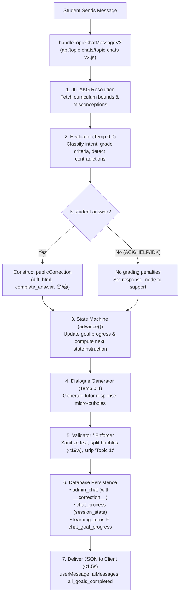
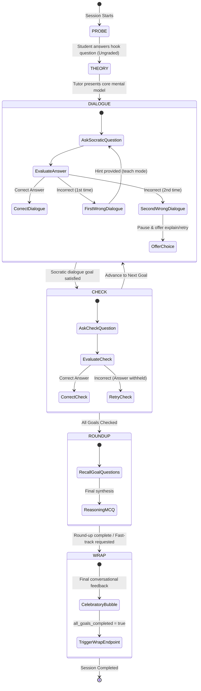
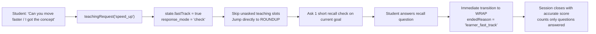
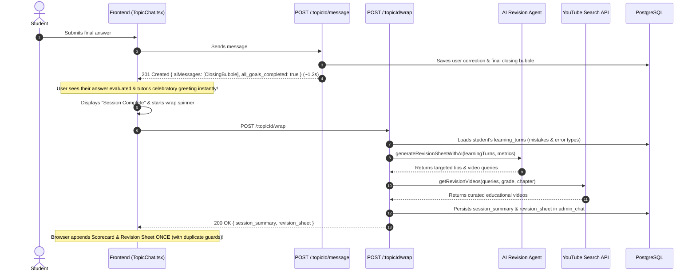

# Tutor Lifecycle & Architecture Flowcharts

> **Visual Architectural Guide: Request Pipeline, State Machine Transitions & Decoupled Session Wrap**  
> *Confidential — Cloop Educational Technologies*

---

## 1. End-to-End Chat Turn Execution

This flowchart depicts what occurs on every student message sent to `POST /api/topic-chats/:topicId/message`:

---

## 2. Pedagogical State Machine & Assistance Ladder

The state machine (`services/tutor-core/state.js`) guides the learner through 6 phases with a deterministic assistance ladder for wrong answers:

---

## 3. Fast-Track ("Move Faster") Lifecycle

When a student indicates they already understand the concept or want to accelerate, the system respects their autonomy without failing unasked work:

---

## 4. Decoupled Wrap & Progressive Revision Sequence

To guarantee instant chat response times (< 1.5s) while still producing deep AI revision sheets and educational YouTube videos, the wrap process is cleanly decoupled:

---

## 5. Related Documentation Links

- [**Cloop AI Tutor Architecture**](file:///c:/cloop/backend/docs/TUTOR_ARCHITECTURE.md)
- [**Socratic Pedagogy & Prompt Engineering Specification**](file:///c:/cloop/backend/docs/SOCRATIC_METHOD_AND_PROMPTS.md)
- [**Complete Codebase Module Map**](file:///c:/cloop/backend/docs/CODEBASE_MODULE_MAP.md)
- [**Curriculum Seeding & Database Schema**](file:///c:/cloop/backend/docs/CURRICULUM_AND_DATABASE.md)
- [**Contributing Guidelines & Architectural Invariants**](file:///c:/cloop/backend/docs/CONTRIBUTING_GUIDELINES.md)

